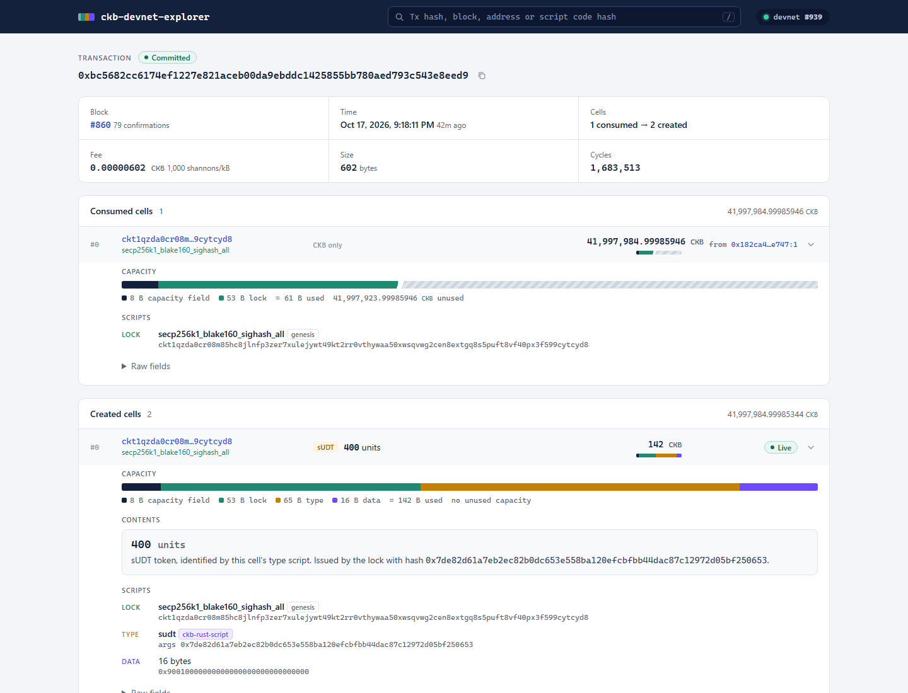
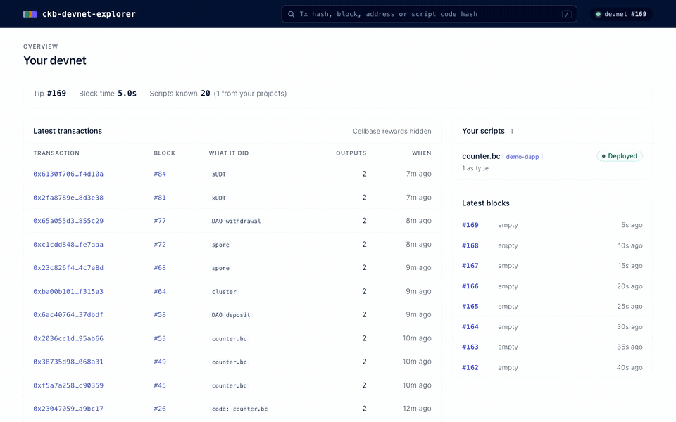

# ckb-devnet-explorer

A lightweight explorer for [OffCKB](https://github.com/ckb-devrel/offckb) devnets. No database, no indexer:
it reads your devnet node directly and labels every script by name, including the ones your own projects deploy.





## Pages

- **Overview**: latest transactions and blocks, refreshed as the devnet mines, plus a "Your scripts" panel
  that says whether each script from your projects is actually deployed on this chain (it catches a stale
  `scripts.json` after `offckb clean`).
- **Transaction**: block, confirmations, fee and fee rate, size, cycles, cell deps, and every consumed and
  created cell as an expandable row.
- **Block**, **address** (balance, tokens, live cells, history) and **script** (where its code lives, which
  cells use it as lock or type).
- **Search** for a tx hash, block number or hash, address, or script code hash. Press `/` to jump to it.

## What it shows

- **Every script by name.** Genesis scripts come from `offckb system-scripts`; your own come from your
  project's `deployment/scripts.json`. JS contracts run by ckb-js-vm are named as the contract, not the VM.
- **What each cell holds.** Contract code (your deployments and the genesis scripts), Nervos DAO deposits and
  withdrawal requests (with the header dep that points at the deposit block), sUDT and xUDT amounts, spores and
  clusters, Type ID cells.
- **How your contracts are used.** For every project script, how many live cells use it as a lock or type,
  including JS contracts, which sit behind `ckb_js_vm` with their own code hash in the args.
- **What each cell's capacity pays for.** 1 CKB of capacity pays for 1 byte, so every cell gets a bar split into
  its capacity field, lock, type, data and leftover capacity.
- **Where cells come from and go.** Inputs are traced back to the transaction that created them; outputs show
  whether they're still live or which transaction spent them.

How it works: [docs/ARCHITECTURE.md](docs/ARCHITECTURE.md). Roadmap: [docs/PLAN.md](docs/PLAN.md).

## Run it

Needs Node 22+, `offckb` on your PATH (`npm i -g @offckb/cli`), and a running devnet (`offckb node`).

From inside a project you deployed with `offckb deploy`, one command, no clone:

```bash
npx github:wildanrhmn/ckb-devnet-explorer serve
```

Then open http://localhost:7070. The current folder is used as the project, so your own scripts are named
straight away.

Other options:

| Option | Default | |
|--------|---------|---|
| `--project <dir>` | current folder | A project deployed with `offckb deploy`. Pass it more than once for several projects. |
| `--rpc <url>` | `http://127.0.0.1:8114` | The devnet node. |
| `--port <n>` | `7070` | Port for the web UI. |
| `--txs <n>` | `10` | How many transactions the terminal version prints. |

Without `serve` it prints the latest transactions to the terminal instead:

```bash
npx github:wildanrhmn/ckb-devnet-explorer --txs 10
```

To install it once instead of fetching it every time:

```bash
npm i -g github:wildanrhmn/ckb-devnet-explorer
ckb-devnet-explorer serve --project ~/path/to/your-ckb-project
```

### From a clone

```bash
git clone https://github.com/wildanrhmn/ckb-devnet-explorer && cd ckb-devnet-explorer
npm install
npm run serve -- --project ~/path/to/your-ckb-project
```

`npm run scan` is the terminal version and `npm run check` type-checks the project.
There is no build step: the source is TypeScript run by [tsx](https://tsx.is), including when installed with npx.
